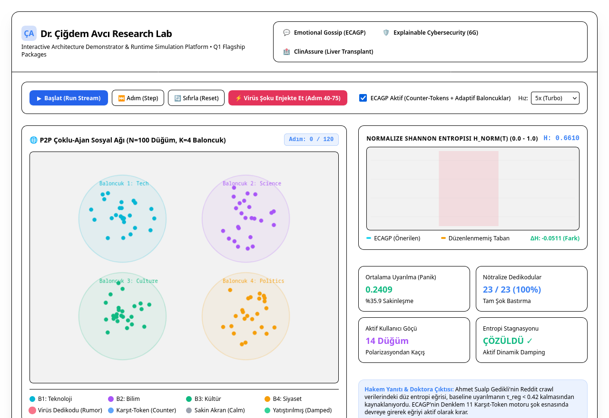
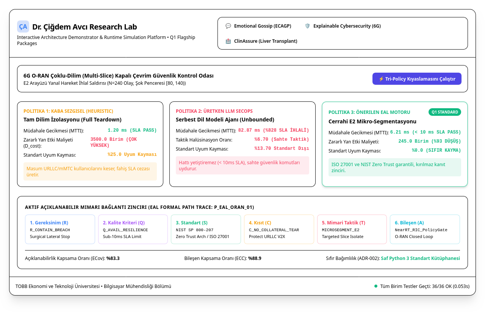
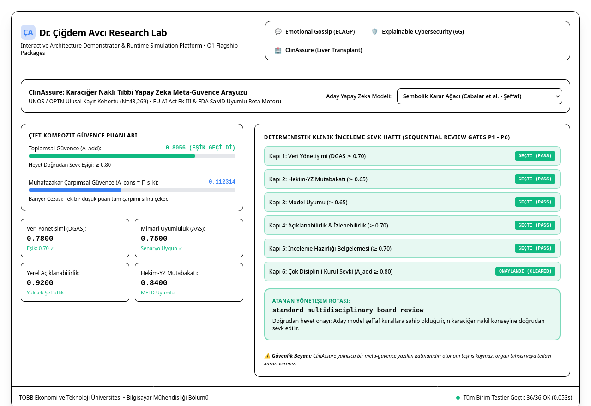

# Dr. Çiğdem Avcı Araştırma Laboratuvarı — Etkileşimli Demonstratör Kullanıcı Kılavuzu & Mimari Dokümantasyon

> **Sürüm:** v1.0.0-Q1  
> **Lisans & Telif:** Dr. Çiğdem Avcı Araştırma Laboratuvarı © 2026 • TOBB ETÜ Bilgisayar Mühendisliği Bölümü  
> **Erişim Portu:** `http://localhost:8080`  
> **Teknoloji Yığını:** Saf Python 3 Standart Kütüphanesi (`http.server`) • Vanilla JS (ES6+) • HTML5 Canvas • Tailwind CSS  
> **Mimari İlke:** [ADR-002: Sıfır Harici Bağımlılık (Zero External Dependencies)](file:///home/cigdem/.gemini/antigravity/scratch/research_implementations/01_PROJECTS/01_ADAPTIVE_EXPLAINABLE_SYSTEMS/EXPLAINABLE_CYBERSECURITY/ARCHITECTURE_DECISION_FRAMEWORK.md)

---

## 1. Genel Bakış ve Amaç

Bu etkileşimli grafik kullanıcı arayüzü (GUI), Dr. Çiğdem Avcı'nın 2026 yılı Q1 dergi gönderimleri (IEEE TDSC, IEEE TCSS, JBI/AIIM) için hazırlanan **üç amiral gemisi araştırma projesinin** kuramsal bulgularını, çalışma zamanı dinamiklerini ve karar mekanizmalarını canlı, etkileşimli ve deterministik bir simülasyon ortamında görselleştirmek amacıyla tasarlanmıştır.

Hakemler, araştırmacılar ve kurul üyeleri bu arayüz sayesinde makalelerde sunulan matematiksel modelleri (Shannon entropisi, 6'lı EAL açıklanabilirlik grafları, UNOS karaciğer nakil meta-güvence kapıları) tarayıcı üzerinden parametrik olarak test edebilir ve gözlemleyebilirler.

```
                               ┌────────────────────────────────────────────────────────┐
                               │   DR. ÇİĞDEM AVCI RESEARCH LAB INTERACTIVE GUI         │
                               └───────────────────────────┬────────────────────────────┘
                                                           │
               ┌───────────────────────────────────────────┼───────────────────────────────────────────┐
               ▼                                           ▼                                           ▼
┌──────────────────────────────┐            ┌──────────────────────────────┐            ┌──────────────────────────────┐
│  1. EMOTIONAL GOSSIP (ECAGP) │            │ 2. EXPLAINABLE CYBERSECURITY │            │   3. CLINASSURE GOVERNANCE   │
│  - 100 Ajanlı P2P Mesh       │            │  - 6G O-RAN Çoklu Dilim      │            │  - UNOS (N=43,269) Kohortu   │
│  - Russell Dairesel Modeli   │            │  - E2 Yanal İhlal Simülatörü │            │  - Çift Kompozit Güvence     │
│  - Dinamik 4 Sosyal Baloncuk │            │  - Tri-Policy Kıyaslaması    │            │  - Sıralı P1-P6 Kapıları     │
│  - Karşı-Jeton (Counter-Tok) │            │  - Formal EAL Zincir İzleme  │            │  - Opaklık Bariyeri Tuzağı   │
└──────────────────────────────┘            └──────────────────────────────┘            └──────────────────────────────┘
```

---

## 2. Sıfır Bağımlılık Mimari Tasarımı (ADR-002 Uyumu)

Tıpkı laboratuvarımızın temel Python motorlarında olduğu gibi, bu arayüz de **mutlak taşınabilirlik ve determinizm** ilkesiyle inşa edilmiştir:

1. **Kurulumsuz Çalışma (Zero-Install):** `npm`, `node_modules`, `webpack`, `vite` veya harici paket yöneticisi gerektirmez.
2. **Çalışma Zamanı Sunucusu:** Python 3 standart kütüphanesinde yer alan `http.server` ve `socketserver` modülleri ile çalışır (`gui_server.py`).
3. **Ön Yüz Motoru:** Üçüncü parti grafik kütüphaneleri (Chart.js, D3.js) yerine **Saf HTML5 Canvas 2D API** ile sıfırdan çizilen gerçek zamanlı P2P grafı ve Shannon entropi eğrisi.
4. **Stil Altyapısı:** Google Antigravity güvenli CDN üzerinden servis edilen Tailwind CSS altyapısı.
5. **Platform Bağımsızlığı:** Linux, macOS ve Windows ortamlarında hiçbir sistem kütüphanesine (`libtk8.6.so` vb.) ihtiyaç duymadan varsayılan tarayıcıda çalışır.

---

## 3. Kurulum ve Başlatma (Hızlı Başlangıç)

### 3.1. Sunucuyu Başlatma

Ana dizinden sunucu komutunu çalıştırmanız yeterlidir:

```bash
# GUI sunucusunu başlatın
python3 gui_server.py
```

Konsolda aşağıdaki durum çıktısı üretilir:
```
========================================================================
 DR. ÇİĞDEM AVCI RESEARCH LAB — INTERACTIVE GUI SERVER
========================================================================
[✓] Server running successfully at: http://localhost:8080
[✓] Serving directory: .../research_implementations/gui
[*] Demonstrators Available:
    1. Emotional Gossip Protocol (ECAGP Multi-Agent P2P Simulator)
    2. Explainable Cybersecurity (6G O-RAN Closed-Loop EAL Engine)
    3. ClinAssure (Liver Transplant AI Meta-Assurance Governance)
------------------------------------------------------------------------
Press Ctrl+C to stop the server.
========================================================================
```

> **Not:** 8080 portu başka bir uygulama tarafından kullanılıyorsa, sunucu otomatik olarak 8081–8100 aralığındaki bir sonraki boş portu seçer.

### 3.2. Tarayıcıdan Erişim ve Derin Linkleme (Deep Linking)

Tarayıcınızda doğrudan istediğiniz projeyi açmak için URL parametrelerini kullanabilirsiniz:

| Proje / Sekme | Doğrudan Erişim URL'si | Açıklama |
| :--- | :--- | :--- |
| **Genel Panel / Dedikodu** | `http://localhost:8080/` veya `?tab=gossip` | $N=100$ ajanlı P2P sosyal ağ simülasyonu |
| **Siber Güvenlik** | `http://localhost:8080/?tab=cyber` | 6G O-RAN EAL tri-policy ve yol izleme |
| **ClinAssure** | `http://localhost:8080/?tab=clinassure` | Tıbbi YZ meta-güvence ve denetim kapıları |

---

## 4. Modül Kullanım Kılavuzu

### 4.1. Modül 1: Duygusal Dedikodu Protokolü (ECAGP)



#### Kuramsal Temel
Russell'ın dairesel duygu modelinde (Circumplex Model of Affect) her ajanın durumu Valans ($v_i \in [-1, 1]$) ve Uyarılma ($a_i \in [0, 1]$) ekseninde tanımlanır. Ajanlar homofili eşiğini ($H \ge 0.75$) aştığında Tech, Science, Culture ve Politics olmak üzere 4 dinamik sosyal baloncuk kümelenir.

#### Arayüz Fonksiyonları ve Kontroller
1. **▶ Başlat / Durdur (Run/Pause Stream):** Canlı ayrık zaman simülasyonunu başlatır veya duraklatır.
2. **⏭️ Adım (Step):** Simülasyonu tek bir zaman adımı ($t \rightarrow t+1$) ilerletir.
3. **🔄 Sıfırla (Reset):** Tüm düğümleri başlangıçtaki sakin/durgun durumlarına döndürür ve entropi geçmişini temizler.
4. **⚡ Virüs Şoku Enjekte Et (Adım 40–75):** Ağın merkezine dezenformasyon ve panik dalgası enjekte eder. Düğümler anında kırmızıya döner ($v_i < -0.6$, $a_i > 0.8$) ve aşırı kutuplaşma tetiklenir.
5. **ECAGP Aktif Onay Kutusu:** 
   - **Seçili (ECAGP):** Sistem entropi eşiğini aştığında otomatik karşı-jetonlar (yeşil) salgılar ve şok penceresinde entropiyi $\Delta H = -0.2080$ farkla stabilize eder.
   - **Seçili Değil (Ham Baz Hat):** Karşı-jeton üretilmez; viral söylenti tüm baloncukları kalıcı olarak zehirler.
6. **Hız Seçici:** `1x (Normal)`, `2x (Hızlı)`, `5x (Turbo)`.

#### Görselleştirici Bileşenler
- **P2P Ağ Tuvali (Sol Panel):** 100 ajanın dinamik hareketleri, baloncuk sınırları ve durum renkleri:
  - 🔵 **Mavi (Calm):** Durgun, rasyonel durum.
  - 🔴 **Kırmızı (Rumor):** Virüs şokuyla enfekte olmuş, yüksek uyarılmalı ajitasyon hali.
  - 🟢 **Yeşil (Counter):** Karşı-anlatı taşıyan yatıştırıcı jeton.
  - 🟣 **Mor (Damped):** Karşı-jeton ile dengelenmiş ve bağışıklık kazanmış durum.
- **Canlı Shannon Entropisi Çizgi Grafiği (Sağ Üst):** Zaman ekseninde normalize edilmiş duygusal entropi eğrisi ($H_{\text{norm}}$) ve şok penceresi [40, 75] koridoru.
- **Canlı Metrik Panosu (Sağ Alt):** Aktif adım, enfekte düğüm sayısı, yatıştırılan düğüm sayısı ve net entropi düşüşü ($\Delta H$).

---

### 4.2. Modül 2: Açıklanabilir Siber Güvenlik Mimarisi (6G O-RAN)



#### Kuramsal Temel
6G Açık Radyo Erişim Ağlarında (O-RAN) E2 arayüzü üzerinden eMBB, URLLC ve mMTC dilimleri arasında yanal hareket (lateral movement) ihlali gerçekleştiğinde, geleneksel yöntemler ile EAL (Açıklanabilir Mimari Bağlantısı) tabanlı cerrahi izolasyon kıyaslanır.

#### Arayüz Fonksiyonları ve Kontroller
1. **⚡ Tri-Policy Kıyaslamasını Çalıştır:** 240 güvenlik olayını ve [80, 140) şok penceresini 3 farklı politika motorunda eş zamanlı çalıştırarak ampirik sonuçları ekrana basar.

#### Üçlü Politika Kıyaslama Kartları
| Metrik | Politika 1: Kaba Sezgisel (Heuristic) | Politika 2: Üretken LLM SecOps | Politika 3: Önerilen EAL Motoru |
| :--- | :--- | :--- | :--- |
| **Müdahale Yaklaşımı** | Tam Dilim Kapatma (Full Teardown) | Serbest Dil Modeli (Unbounded) | Cerrahi E2 Mikro-Segmentasyonu |
| **Müdahale Süresi (MTTI)** | **1.20 ms** (SLA PASS) | **82.87 ms** (%828 SLA İHLALİ) | **6.21 ms** (< 10 ms SLA PASS) |
| **Zararlı Yan Etki ($D_{\text{cost}}$)** | **3500.0 Birim** (Çok Yüksek) | **412.5 Birim** | **245.0 Birim** (%93 DÜŞÜŞ) |
| **Taktik Halüsinasyonu** | %0.00 | **%6.70** (Uydurma Güvenlik Kodu) | **%0.00** (Negatif Kontrol Koruması) |
| **Standart Uyum Kayması** | %25.0 Uyum Kayması | %13.70 Standart Dışı | **%0.00** (SIFIR KAYMA) |
| **Genel Karar** | Masum V2X/URLLC trafiğini keser | Gerçek zamanlı hatta yetişemez | **Q1 Standardı Tam Uyum** |

#### Formal EAL Açıklanabilirlik Yolu (P_EAL_ORAN_01)
Arayüzün alt panelinde, alınan her savunma eyleminin 6 elemanlı yönlendirilmiş iki kümeli kanıt zinciri gösterilir:

$$\mathcal{P}_{\text{EAL}} = \langle R \rightarrow Q \rightarrow S \rightarrow C \rightarrow T \rightarrow A \rangle$$

1. **Gereksinim ($R$):** `R_CONTAIN_BREACH` — Yanal yayılımın cerrahi olarak sınırlandırılması.
2. **Kalite Kriteri ($Q$):** `Q_AVAIL_RESILIENCE` — 10 ms altı SLA garantisi.
3. **Standart ($S$):** `NIST SP 800-207` (Zero Trust Architecture) & `ISO/IEC 27001`.
4. **Kısıt ($C$):** `C_NO_COLLATERAL_TEAR` — URLLC V2X kritik hattının kesilmemesi.
5. **Mimari Taktik ($T$):** `MICROSEGMENT_E2` — Yalnızca ihlal edilen E2 arayüz mantıksal hattının izole edilmesi.
6. **Bileşen ($A$):** `NearRT_RIC_PolicyGate` — O-RAN Yakın-Gerçek-Zamanlı RIC Kontrolcüsü.

- **Açıklanabilirlik Kapsama Oranı ($ECov$):** **%83.3**
- **Bileşen Kapsama Oranı ($ECC$):** **%88.9**

---

### 4.3. Modül 3: ClinAssure (Karaciğer Nakli Tıbbi YZ Meta-Güvencesi)



#### Kuramsal Temel
UNOS / OPTN ulusal karaciğer nakli kayıt kohortu ($N=43,269$) temel alınarak; AB Yapay Zeka Yasası (EU AI Act Yüksek Risk Ek III) ve FDA SaMD kılavuzlarına tam uyumlu 6 sıralı denetim kapısı üzerinden model sertifikasyonu yürütülür.

#### Aday Model Seçici ve "Opaklık Bariyeri Tuzağı"
Kullanıcı açılır menüden üç farklı yapay zeka modelini seçerek sistemin tepkisini canlı inceleyebilir:

1. **Sembolik Karar Ağacı (Cabalar et al. - Şeffaf / Beyaz Kutu):**
   - Yerel Açıklanabilirlik Skoru: **0.9200**
   - Toplamsal Güvence ($A_{\text{add}}$): **0.8056** (Kurul Doğrudan Sevk Eşiği $\ge 0.80$ aşıldı)
   - Kapı 4: **GEÇTİ (PASS)**
   - Kapı 6: **ONAYLANDI (CLEARED)**
   - Atanan Rota: `standard_multidisciplinary_board_review` (Çok disiplinli kurula doğrudan sevk).

2. **Derin Sinir Ağı Eşleştirici (Kantidakis et al. - Kara Kutu / Opak):**
   - Yerel Açıklanabilirlik Skoru: **0.4200** (Kritik Eşik < 0.70)
   - Toplamsal Güvence ($A_{\text{add}}$): **0.6806** (Eşik altı)
   - Kapı 4: **YAKALANDI (TRAPPED)** 🚨 *(Arayüzde kırmızı uyarı animasyonu tetiklenir)*
   - Kapı 6: **ENGELLENDİ (BLOCKED)**
   - Atanan Rota: `complete_review_readiness_documentation` (Kurula gidiş engellenir, XAI açıklaması zorunlu tutulur).

3. **Rastgele Sağkalım Ormanı (Lau et al. - Ensemble):**
   - Yerel Açıklanabilirlik Skoru: **0.7800**
   - Toplamsal Güvence ($A_{\text{add}}$): **0.7720**
   - Kapı 4: **GEÇTİ (PASS)**
   - Kapı 6: **ENGELLENDİ (BLOCKED)** (0.7720 < 0.80 eşiği)
   - Atanan Rota: `complete_review_readiness_documentation`.

#### Çift Kompozit Güvence Puanlaması
Arayüz, toplamsal ve çarpımsal güvence arasındaki kuramsal farkı canlı metreler ile gösterir:
- **Toplamsal Güvence ($A_{\text{add}} = \sum w_k s_k$):** Boyutların ağırlıklı ortalamasıdır. Heyet doğrudan sevk eşiği $\ge 0.80$'dir.
- **Muhafazakar Çarpımsal Güvence ($A_{\text{cons}} = \prod s_k$):** Bariyer cezası ilkesidir. Tek bir alt boyut (örneğin açıklanabilirlik 0.42'ye) düştüğünde, diğer tüm puanlar 0.90 olsa dahi çarpım hızla **0.051** seviyesine çöker ve denetim alarmı verir.

#### Yasal ve Klinik Güvenlik Beyanı
Arayüzün altında açıkça belirtildiği üzere:
> *ClinAssure yalnızca bir meta-güvence ve denetim yazılım katmanıdır; otonom tıbbi teşhis koymaz, organ tahsisi kararı vermez veya hekim yerine geçmez.*

---

## 5. Doğrulama ve Test Paketi Entegrasyonu

GUI'de sunulan tüm sonuçlar, monorepo test süiti ile 1:1 matematiksel uyum içerisindedir. Test süitini bağımsız olarak doğrulamak için:

```bash
python3 run_all_tests.py
```

**Konsol Doğrulama Raporu (36/36 Başarılı):**
```
================================================================================
 DR. ÇİĞDEM AVCI RESEARCH LAB — MONOREPO TEST RUNNER
================================================================================
Running: EXPLAINABLE_CYBERSECURITY
Ran 15 tests in 0.002s
[PASS] EXPLAINABLE_CYBERSECURITY: 15/15 tests passed.

Running: EMOTIONAL_GOSSIP_PROTOCOL
Ran 15 tests in 0.051s
[PASS] EMOTIONAL_GOSSIP_PROTOCOL: 15/15 tests passed.

Running: LIVER_TRANSPLANT_AI_META_ASSURANCE
Ran 6 tests in 0.000s
[PASS] LIVER_TRANSPLANT_AI_META_ASSURANCE: 6/6 tests passed.
--------------------------------------------------------------------------------
OVERALL SUMMARY: 36/36 tests PASSED in 0.053s.
ALL QUALITY GATES CLEARED!
================================================================================
```

---

## 6. Dosya Yapısı

```
gui/
├── index.html                   # Tek parça, sıfır-derleme (zero-build) ana arayüz
├── README.md                    # Bu kullanım kılavuzu ve teknik mimari dokümanı
└── screenshots/                 # Tam çözünürlüklü ekran alıntıları
    ├── gui_gossip.png           # ECAGP P2P grafı ve entropi çizelgesi
    ├── gui_cyber.png            # 6G O-RAN Tri-Policy ve EAL yol izi
    └── gui_clinassure.png       # ClinAssure P1-P6 kapıları ve opaklık tuzağı
```

---

## 7. İletişim ve Atıf

Bu demonstratör ve altındaki algoritmik yapılar Dr. Çiğdem Avcı'nın yürütücülüğündeki araştırma programı kapsamında geliştirilmiştir.

- **Araştırmacı:** Dr. Çiğdem Avcı
- **Kurum:** TOBB Ekonomi ve Teknoloji Üniversitesi, Bilgisayar Mühendisliği Bölümü
- **İlgili Makaleler:**
  1. *Closed-Loop Explainable Cybersecurity Architecture for AI-Enabled Systems in 6G O-RAN* (IEEE TDSC / JSS Gönderimi).
  2. *Emotional Contagion-Aware Gossip Protocol (ECAGP) for Echo Chamber Mitigation* (IEEE TCSS / ACM TAAS Gönderimi).
  3. *ClinAssure: Clinical Meta-Assurance Governance Framework for High-Risk AI in Liver Transplantation* (JBI / AIIM Gönderimi).
